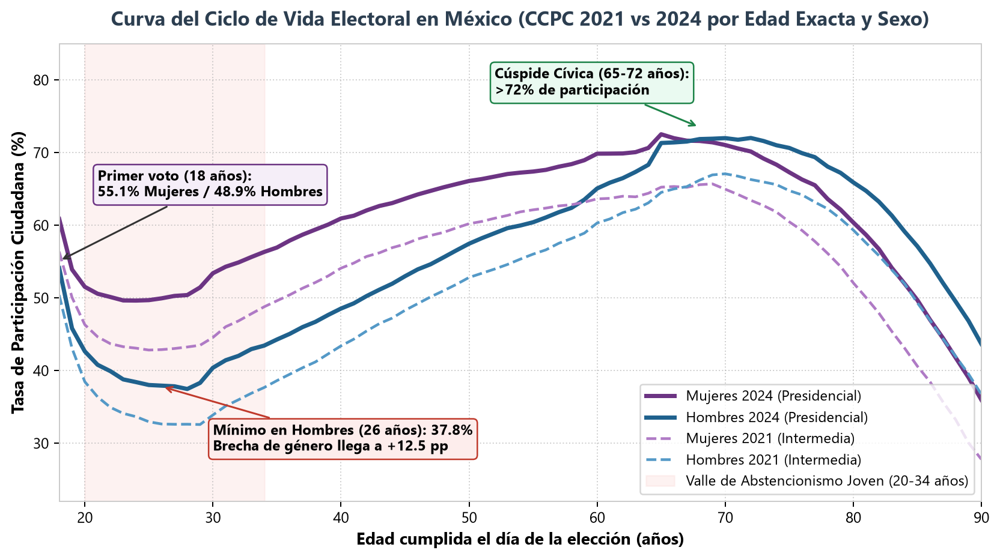
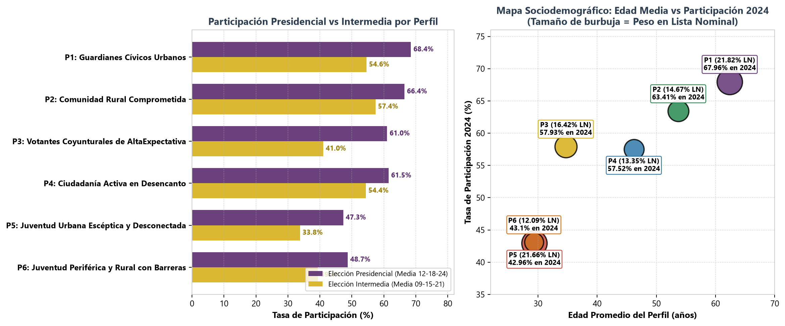
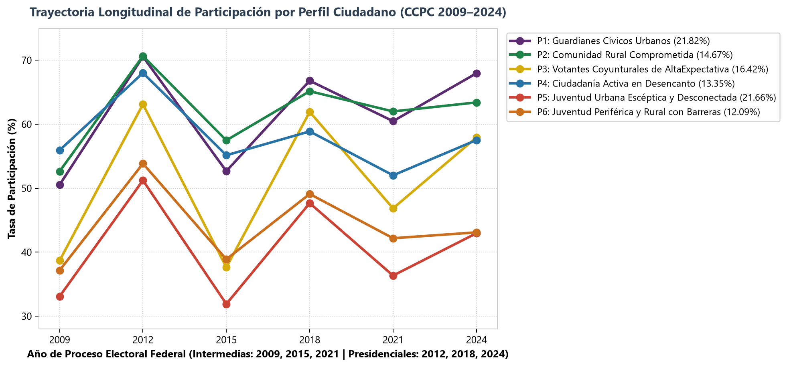

# 🗳️ HACKEA LA PARTICIPACIÓN: Datos que Construyen Democracia (INE · DECEyEC · ENCÍVICA)
### Reto 1: Perfiles Ciudadanos de Participación — Segmentación Sociodemográfica CCPC 2009–2024

[](https://github.com/IsraQuanDev/Hackea_INE_perfiles_ciudadanos/actions/workflows/deploy-pages.yml)

🌐 **Dashboard Interactivo en Vivo (GitHub Pages):**  
👉 **[https://israquandev.github.io/Hackea_INE_perfiles_ciudadanos/](https://israquandev.github.io/Hackea_INE_perfiles_ciudadanos/)**

---

## 📌 Resumen del Proyecto

Este proyecto responde al **Reto 1 (Perfiles ciudadanos de participación)** de la convocatoria nacional **Hackea la Participación: Datos que construyen democracia** del **Instituto Nacional Electoral (INE)**.

Procesamos el **100% de los Conteos Censales de Participación Ciudadana (CCPC) 2009–2024**:
- **54,872,712 registros agregados** leídos de **194 archivos CSV** (6 elecciones federales ordinarias en las 32 entidades federativas: 2009, 2012, 2015, 2018, 2021 y 2024 + Voto Anticipado 2024 + Voto en Prisión Preventiva 2024).
- **Lista Nominal CCPC 2024 analizada:** **98,330,348** ciudadanas y ciudadanos en cuadernillos (**55.83%** de participación efectiva).
- **Cobertura geográfica total:** **32 Entidades Federativas** y **2,477 Municipios**.

---

## 📊 Principales Hallazgos y Modelo de Segmentación (*Clustering*)

### 1. La Curva del Ciclo de Vida Electoral y la Paradoja del "Segundo Voto"


- **Entusiasmo a los 18 años y desplome de los 20 a los 34 años:** A los 18 años votan el **55.1% de las mujeres** y el **48.9% de los hombres**, pero inmediatamente después se abre el **"Valle de Abstencionismo Joven"**, tocando fondo a los **26 años en hombres (37.8% en 2024 y 28.4% en la intermedia de 2021)**.
- **Liderazgo cívico femenino (+7.68 pp en 2024):** Las mujeres participan al **59.51%** frente al **51.83%** de los hombres, superándolos en todos los rangos de edad desde los 18 hasta los 75 años.
- **Nuevas Modalidades e Inclusión 2024:**
  - **Personas No Binarias (`SEXO = 2`):** **75.24%** de participación (79 votantes de 105 en Lista Nominal).
  - **Voto Anticipado 2024:** **3,449 votantes** (**62.1% mujeres**).
  - **Prisión Preventiva 2024:** **26,563 votantes** (**91.2% hombres**).

---

### 2. Los 6 Perfiles Ciudadanos de Participación (*K-Means Ponderado por Lista Nominal*)


| ID | Nombre del Perfil Ciudadano | Peso en Padrón 2024 (`LN`) | Voto 2024 | Media Presidencial | Media Intermedia | Brecha Pres-Inter | Edad Media | % Mujeres | Entorno Dominante | Escolaridad Est. | Tendencia (09–24) |
| :-: | :--- | :---: | :---: | :---: | :---: | :---: | :---: | :---: | :---: | :---: | :---: |
| **P1** | **🏛️ Guardianes Cívicos Urbanos** | **21.82%** *(21.46M)* | **67.96%** | 68.44% | 54.56% | 13.88 pp | 62.4 años | 63.1% | Urbano (95.6%) | 9.6 años | **+3.67 pp** 📈 |
| **P2** | **🌾 Comunidad Rural Comprometida** | **14.67%** *(14.42M)* | **63.41%** | 66.41% | **57.37%** | **9.04 pp** | 53.7 años | 62.1% | Rural/Mixto | 6.7 años | **+1.06 pp** 📈 |
| **P3** | **⚡ Votantes Coyunturales de Alta Expectativa** | **16.42%** *(16.14M)* | **57.93%** | 60.99% | 41.05% | **19.94 pp** | 34.7 años | **68.2%** | Urbano (97.1%) | 11.8 años | **+1.49 pp** 📈 |
| **P4** | **📉 Ciudadanía Activa en Desencanto** | **13.35%** *(13.12M)* | **57.52%** | 61.47% | 54.36% | 7.11 pp | 46.2 años | 55.0% | Urbano/Mixto | 10.8 años | **-7.21 pp** 📉 |
| **P5** | **🏙️ Juventud Urbana Escéptica y Desconectada** | **21.66%** *(21.30M)* | **42.96%** | 47.29% | **33.78%** | 13.51 pp | 29.4 años | 30.6% *(69.4% H)* | Urbano (100%) | 11.8 años | **-2.51 pp** 📉 |
| **P6** | **🚧 Juventud Periférica y Rural con Barreras** | **12.09%** *(11.88M)* | **43.10%** | 48.68% | 39.41% | 9.27 pp | 29.3 años | 32.6% *(67.4% H)* | Rural/Mixto | 8.9 años | **-2.87 pp** 📉 |



---

## 🚀 Arquitectura y Estructura del Repositorio

```text
├── .github/workflows/
│   └── deploy-pages.yml            # CI/CD con GitHub Actions para despliegue automático en GitHub Pages
├── processed_data/                 # Bases consolidadas en Parquet y payloads JSON de alta velocidad
│   ├── ccpc_macro_2009_2024.parquet
│   ├── ccpc_municipio_2009_2024.parquet
│   ├── ccpc_seccion_2009_2024.parquet
│   ├── ccpc_perfiles_final.parquet
│   └── dashboard_data_pro.json
├── figures/                        # Visualizaciones de alta resolución
├── index.html                      # Aplicación Web Interactiva (Zero-Backend SVG Engine + Tailwind)
├── app_streamlit.py                # Aplicación para Streamlit Cloud / Ejecución Local
├── pipeline_eda.py                 # Lectura paralela PyArrow de los 194 CSVs (54.87M filas)
├── clustering_perfiles.py          # Ingeniería de características y K-Means ponderado
├── enrich_municipal_data.py        # Clasificación de los 2,477 municipios
└── build_pro_dashboard.py          # Compilador del dashboard interactivo
```

---

## 💻 Ejecución Local

1. **Clonar el repositorio e instalar dependencias:**
   ```bash
   git clone https://github.com/IsraQuanDev/Hackea_INE_perfiles_ciudadanos.git
   cd Hackea_INE_perfiles_ciudadanos
   pip install -r requirements.txt
   ```
2. **Abrir el Dashboard Web o ejecutar con Streamlit:**
   ```bash
   # Opción A: Servidor estático ultrarrápido
   python -m http.server 8080
   # Opción B: Servidor Streamlit
   python -m streamlit run app_streamlit.py
   ```
